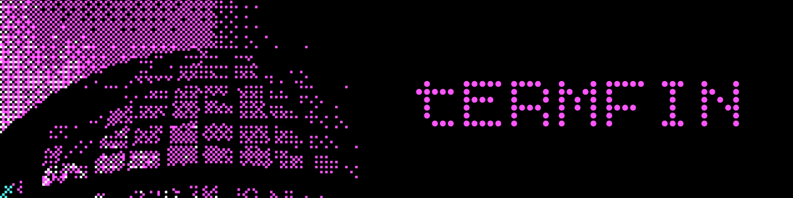

<p align="center">
  
</p>

<p align="center">
  <strong>TUI minimalista y reactiva para diagnóstico financiero en tiempo real.</strong>
</p>

<p align="center">
  
  
  
  
</p>

---

**TermFin** es una herramienta de terminal (TUI). Permite ingresar datos contables clave y obtener cálculos, métricas y diagnósticos automáticos en vivo sin salir de la consola.

---

## Características

- **Cálculos en tiempo real:** A medida que escribes, recalcula utilidad neta, variación vs presupuesto, exceso de egresos y tasa de morosidad.
- **Semáforo de salud global:** Evalúa tus finanzas con indicadores visuales instantáneos (`🟢 NORMAL`, `🟡 ADVERTENCIA`, `🔴 CRÍTICO`).
- **Formato inteligente:** Auto-formateo con separadores de miles y decimales (`$820,000.00`) con vista previa en vivo.
- **Keyboard-First:** Diseñado para usarse 100% con teclado, ágil y sin fricciones.
-  **Full Responsive:** Se adapta automáticamente a todo el ancho y alto disponible en tu terminal.

---

## Instalación y Uso

### 1. Clonar el repositorio
```bash
git clone https://github.com/hectorolivares/termfin-tui
cd termfin-tui
```

### 2. Instalar dependencias
```bash
pip install -r requirements.txt
```

### 3. Iniciar la aplicación
```bash
python main.py
```

---

## Controles

| Tecla | Acción |
| :--- | :--- |
| **`Tab` / `Enter` / `↓`** | Siguiente campo (aplica auto-formato) |
| **`Shift + Tab` / `↑`** | Campo anterior |
| **`Esc` / `Ctrl + C`** | Salir de la aplicación |

---

## Stack

- **[Python](https://www.python.org/)** (>= 3.10)
- **[prompt_toolkit](https://github.com/prompt-toolkit/python-prompt-toolkit)**: Motor de interfaz, eventos y captura interactiva de teclado.
- **[Rich](https://github.com/Textualize/rich)**: Renderizado de tablas, paneles, colores ANSI y estética de terminal.

---

<p align="center">
    <samp align="center">HCTR / MONN GC</samp>
</p>


